 

# 📊 Awesome Sales BI & Analytics

> **A curated ecosystem of commercial SaaS platforms, open-source BI engines, pipeline dashboards, and self-hosted revenue intelligence tools.**

*Focused on sales performance management, CRM analytics, sales forecasting accuracy, pipeline dashboards, and data-driven revenue operations.*

---

## 📌 Table of Contents

- [🌐 Market Overview & Dynamics](#-market-overview--dynamics)
- [💼 Commercial SaaS Platforms](#-commercial-saas-platforms)
- [🔥 Open-Source GitHub Projects](#-open-source-github-projects)
  - [📊 Top Open-Source BI & Analytics Repos (Sorted by Star Count)](#-top-open-source-bi--analytics-repos-sorted-by-star-count)
  - [⚡ Modern Sales Analytics Stack Frameworks](#-modern-sales-analytics-stack-frameworks)
- [🤝 How to Contribute](#-how-to-contribute)
- [💖 Support & Sponsorship](#-support--sponsorship)
- [⚠️ Disclaimer](#%EF%B8%8F-disclaimer)
- [⭐ Star History](#-star-history)

---

## 🌐 Market Overview & Dynamics

> **💡 Market Size & Sector Structure:**  
> The global **Sales Business Intelligence (BI) & Revenue Analytics Market** is estimated at **~$32.5 Billion in 2026** and is expanding at a Compound Annual Growth Rate (CAGR) of **~11.8%**.  
>  
> The market is **moderately fragmented**: Enterprise deployments remain heavily dominated by cloud technology conglomerates (*Microsoft*, *Salesforce*, *Google Cloud*), while mid-market sales organizations and fast-growing startups leverage specialized revenue intelligence platforms alongside self-hosted open-source analytical semantic layers.

---

## 💼 Commercial SaaS Platforms

Below is a structured analysis of leading commercial **Sales BI & Revenue Analytics** SaaS platforms, sorted by **Company Size (Valuation / Revenue) descending**.

| 🏢 SaaS Platform | 💰 Specific Starting Pricing | 🎁 Free Tier / Trial Limits | 📈 Size (Valuation / Revenue) | 🎯 Best For & Key Features |
| :--- | :--- | :--- | :--- | :--- |
| **[Microsoft Power BI](https://powerbi.microsoft.com/)** | **$10.00 / user / month** (Pro Plan) | **Free Forever** (Power BI Desktop, 10 GB limit) | **~$3,100.00 Billion** ($245B Rev) | **Microsoft-centric sales teams** — Deep Excel, Azure & Microsoft 365 integration with Copilot AI. |
| **[Looker (Google Cloud)](https://looker.com/)** | **$125.00 / user / month** (Standard Plan) | **14-Day Free Trial** (Enterprise Sandbox) | **~$2,100.00 Billion** ($330B Rev) | **Governed enterprise metrics** — LookML semantic modeling layer for consistent sales metrics across BigQuery. |
| **[Salesforce Sales Wave Analytics](https://www.salesforce.com/)** | **$75.00 / user / month** (CRM Analytics Growth) | **30-Day Free Trial** (Sales Cloud Einstein) | **~$280.00 Billion** ($34.9B Rev) | **Salesforce CRM users** — Native pipeline dashboards, rep forecasting roll-ups, and Einstein AI insights. |
| **[Qlik Sense](https://www.qlik.com/)** | **$30.00 / user / month** (Standard Cloud) | **30-Day Free Trial** (Full Cloud Enterprise) | **~$10.00 Billion** ($1.2B Rev) | **Exploratory sales analytics** — Unique associative engine surfacing non-obvious sales relationships. |
| **[ThoughtSpot](https://www.thoughtspot.com/)** | **$95.00 / user / month** (Team Plan) | **30-Day Free Trial** (Unlimited Search Queries) | **~$4.20 Billion** ($150M ARR) | **Search-driven analytics** — Natural language queries powered by SpotIQ AI for instant sales insights. |
| **[Domo](https://www.domo.com/)** | **$300.00 / month** (Base Tier + Consumption) | **Free Forever** (30 Credit Limit) & 30-Day Trial | **~$1.80 Billion** ($320M Rev) | **Business-user self-service** — 1,000+ connectors, automated ETL, and interactive executive dashboards. |
| **[Sigma Computing](https://www.sigmacomputing.com/)** | **$50.00 / user / month** (Standard Tier) | **14-Day Free Trial** (Data Warehouse Connection) | **~$1.50 Billion** ($100M ARR) | **Cloud warehouse analytics** — Spreadsheet interface operating directly on Snowflake, Databricks, and BigQuery. |
| **[Sisense](https://www.sisense.com/)** | **$83.00 / user / month** ($1,000/yr minimum) | **30-Day Free Trial** (Full Fusion Engine) | **~$1.10 Billion** ($150M Rev) | **Embedded sales dashboards** — In-chip analytical processing for embedding custom analytics into apps. |
| **[InsightSquared](https://www.insightsquared.com/)** | **$65.00 / user / month** (Essential Tier) | **14-Day Free Trial** (Guided Sandbox) | **~$300.00 Million** ($40M Rev) | **Mid-market Revenue Operations** — Pipeline velocity, rep coaching, and automated sales forecast accuracy. |

---

## 🔥 Open-Source GitHub Projects

Open-source tools empower sales operations analysts and engineers to build sovereign, custom, and cost-effective sales BI infrastructure.

### 📊 Top Open-Source BI & Analytics Repos (Sorted by Star Count)

All repositories below are sorted in **descending order by GitHub star count**. Star badges link directly to the repository's official **Stargazers** page.

1. 🦊 **[Grafana](https://github.com/grafana/grafana)**   
   **The standard for operational dashboards & alerting**, AGPL-3.0 licensed. Connects to PostgreSQL, MySQL, and Prometheus for real-time operational sales monitoring and outlier detection.

2. ⚡ **[Apache Superset](https://github.com/apache/superset)**   
   **Enterprise-grade data exploration & dashboarding platform**, Apache-2.0 licensed. Features a rich SQL IDE, semantic layer, Jinja templating, and AI-driven intelligence layer for sales teams.

3. 🔍 **[Metabase](https://github.com/metabase/metabase)**   
   **No-code BI and self-service analytics**, AGPL-3.0 licensed. Enables non-technical sales managers to ask complex pipeline questions and create automated visual reports without writing SQL.

4. 🚀 **[ClickHouse](https://github.com/ClickHouse/ClickHouse)**   
   **Columnar real-time analytical database**, Apache-2.0 licensed. Delivers sub-second query performance over billions of CRM event logs and sales transactions.

5. 🌪️ **[Apache Airflow](https://github.com/apache/airflow)**   
   **Workflow orchestration platform**, Apache-2.0 licensed. Python-based DAGs for orchestrating complex CRM data pipelines, sales ETL/ELT, and forecasting models.

6. 🐍 **[Streamlit](https://github.com/streamlit/streamlit)**   
   **Python framework for rapid data app creation**, Apache-2.0 licensed. Transforms Python data science scripts into interactive, custom sales analytics web applications.

7. 📈 **[Redash](https://github.com/getredash/redash)**   
   **SQL-driven query editor and visualization platform**, BSD-2-Clause licensed. Simple interface to query databases, build charts, and share dashboards across sales teams.

8. 🦆 **[DuckDB](https://github.com/duckdb/duckdb)**   
   **In-process analytical database ("SQLite for Analytics")**, MIT licensed. Extremely fast zero-dependency analytical query engine over local CSV/Parquet CRM exports.

9. 🧊 **[Cube](https://github.com/cube-js/cube)**   
   **Universal semantic layer for analytics & AI**, MIT licensed. Headless BI engine ensuring consistent sales KPI definitions across REST, SQL, GraphQL, and MDX interfaces.

10. 🐘 **[Apache Doris](https://github.com/apache/doris)**   
    **Real-time MPP analytical database**, Apache-2.0 licensed. Designed for high-concurrency real-time sales reporting and ad-hoc SQL analytics.

11. 🌟 **[StarRocks](https://github.com/StarRocks/starrocks)**   
    **Next-gen real-time analytics database**, Apache-2.0 licensed. Powers unified real-time analytics across data lakes and CRM data warehouses.

12. 💡 **[Lightdash](https://github.com/lightdash/lightdash)**   
    **Open-source Looker alternative for dbt users**, MIT licensed. Converts dbt metric definitions directly into self-service sales dashboards and charts.

13. 📄 **[Evidence](https://github.com/evidence-dev/evidence)**   
    **Code-based Business Intelligence**, MIT licensed. Build fast, publication-grade sales reports and executive briefs using Markdown and SQL.

14. 🔀 **[Jitsu](https://github.com/jitsucom/jitsu)**   
    **Open-source event collection platform**, MIT licensed. Captures user touchpoints and website interactions to feed product-led sales analytics.

15. ⚡ **[Rill Data](https://github.com/rilldata/rill)**   
    **Operational BI engine for local analytical datasets**, Apache-2.0 licensed. Instant interactive dashboards built on DuckDB for rapid sales dataset exploration.

---

### ⚡ Modern Sales Analytics Stack Frameworks

To assemble a complete open-source Sales BI architecture:
* **Visualization Layer**: Combine **Apache Superset** or **Metabase** for non-technical sales user access.
* **App Layer**: Use **Streamlit** or **Evidence.dev** for bespoke sales commission calculators and forecast models.
* **Semantic Layer**: Deploy **Cube** or **Lightdash** to lock down governed metrics (MRR, ARR, Win Rate, Churn).
* **Database Backend**: Query CRM snapshots using **ClickHouse**, **DuckDB**, or **Apache Doris**.
* **Data Pipelines**: Ingest CRM data via **Airbyte** or **Jitsu**, transformed with **dbt**, and orchestrated with **Apache Airflow**.

---

## 🤝 How to Contribute

Contributions are welcome! Help build the definitive open resource for Sales BI & Analytics:

1. 🍴 **Fork** the repository.
2. 📝 **Add or edit** entries in `README.md` following the tabular or badged standards.
3. 🔍 Include verified data: **Product Name**, **Exact Starting Price**, **Free Trial/Tier limits**, and **Valuation/Stars**.
4. 🚀 **Submit a Pull Request** with a clear description of changes.

---

## 💖 Support & Sponsorship

If you find this repository helpful for your sales operations, revenue engineering, or BI stack selection, please consider supporting the project!

- ⭐ **Star** this repository to show appreciation.
- 🔀 **Fork** and share it with your network on LinkedIn, Twitter, and Reddit.
- ☕ **Sponsor the Maintainer**: Support continuous updates and repository curation via the [GitHub Sponsor Dashboard](https://github.com/sponsors/ishandutta2007).

---

## ⚠️ Disclaimer

- This list is **community-curated** for research purposes and does not represent official endorsement.
- **Data Security & Compliance**: Sales analytics systems process sensitive customer details and revenue figures. Ensure end-to-end security, role-based access control, and GDPR/CCPA compliance.
- **Data Hygiene**: BI outputs depend strictly on CRM data quality. Implement data validation pipelines (e.g. Great Expectations) to prevent misleading pipeline reports.
- **License Compliance**: Verify open-source licenses (Apache-2.0, MIT, AGPL-3.0) against your corporate policy before deployment.

---

## ⭐ Star History

---

*Curated with ❤️ for sales ops analysts, revenue leaders, and data engineers worldwide.*
